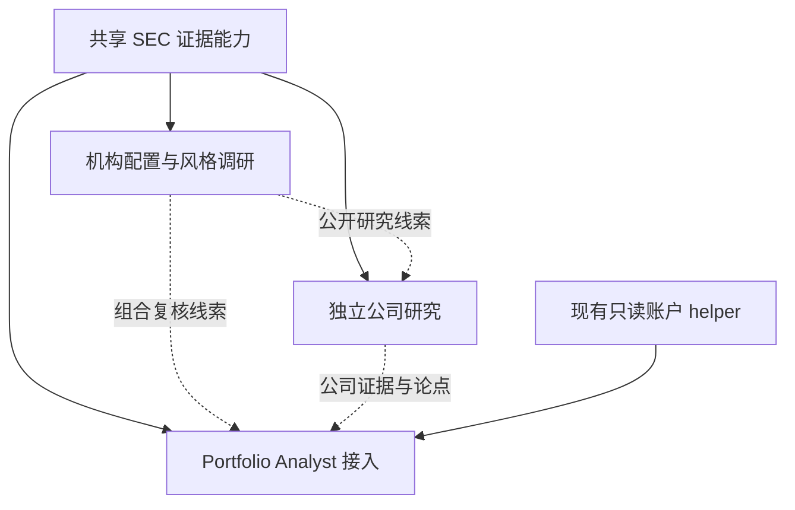

# SEC 研究体系设计

日期：2026-10-16。状态：V1 设计基线，已进入实现与验收。
实际功能、测试及限制见[实现记录](../../../../Futu%20API%20Skills/sec-research-core/docs/implementation.md)。

本设计将用户已确认的三个流程连接起来：机构配置与风格调研发现选题，公司独立研究检验经营与投资论点，portfolio-analyst 将证据转化为组合判断。三者可分别运行，通过公开证据复用协作，不要求每次串行跑完整链路。

## 1. 已确认的需求与设计假设

已确认：

- 增加独立公司研究流程，支持财报、业务、风险及投资论点探索。
- 将 SEC 原始披露能力融入现有 portfolio-analyst。
- 增加跨机构 13F 调仓研究，寻找行业、主题、投资风格变化的提示。
- **13F 机构池由用户通过可配置名单指定**。不自动添加规模榜单、知名基金或系统推荐机构。

本版采用的设计默认值（可调整，不是用户已确认的交易偏好）：

- 手动触发，以中文 Markdown 报告交付；默认不保存运行结果，不启动定时任务或推送。
- 机构名单是用户维护的配置；公共披露的跨季度比较可在同次运行内完成，不以持久数据库为前提。
- 独立公司研究默认一家公司；机构调研默认四个季度末快照、最多三个相邻季度变化。
- V1 优先行业、明确的业务主题和规模结构。成长／价值等风格只有在分类数据与方法合格时才输出。
- 所有研究只读；现有账户快照、风险、技术、期权引擎保持其现有职责。

## 2. 能力划分与 spec 索引

| 模块 ID | 责任 | 规范 | 依赖 |
|---|---|---|---|
| `sec-evidence` | SEC 文件选择、时间口径、事实溯源、完整性与最小公共数据辅助程序 | [共享证据规范](SPEC-sec-evidence.md) | 已授权 EdgarTools MCP／SDK、原始 SEC 文件 |
| `company-research` | 独立公司研究、反证、同行比较与研究结论 | [公司研究](SPEC-company-research.md) | `sec-evidence` |
| `institutional-style` | 用户机构池、13F 有效持仓、跨期变化及风格线索 | [机构配置与风格调研](SPEC-institutional-style.md) | `sec-evidence` |
| `portfolio-integration` | 在现有研究预算与账户边界内消费公开研究结果 | [Analyst 接入](SPEC-portfolio-integration.md) | `sec-evidence`；可选消费另两模块结果 |

[统一验收规范](ACCEPTANCE.md)列出跨模块验收条件、数据样例与验证方式。

模块边界延续本次对话已确认的三个研究流程；`sec-evidence` 是它们共享的底层规则，不增加第四个面向用户的研究产品。



虚线代表同一宿主中的证据交接，不是新建 RPC、后台服务或自动启动其他代理。公司研究可以独立接收一个问题；analyst 可以直接查证一项 SEC 事实，无需先生成完整公司研报。

建议实现顺序：共享证据与数据完整性 → 公司研究和 13F 有效持仓／变化计算 → 机构风格归纳 → analyst 接入。此处仅定义依赖，不替代后续实现任务计划。

## 3. 当前代码与工具基线

- 现有 analyst 版本为 0.8.0；账户来源是一次性 `scripts/current_analysis.py`，研究在宿主内进行。
- `scripts/portfolio.py` **没有 research 命令**，本设计也不向账户 CLI 增加该命令。
- 本机查到 uv tool 环境中的 `edgartools==5.62.0`；当前宿主暴露 13 个 EdgarTools MCP 工具。MCP 运行实例的实际包版本仍需实施时单独记录，不能仅由本机 distribution 推断。
- 设计阶段实测 AAPL 年报定位、MD&A 读取及四期趋势；后续已完成只读 SDK、合成机构池与合成组合联合验证，详见实现记录。未采集真实账户。
- MD&A 实测存在截断；本机 reader 实现每章节截取 6,000 字符。季度趋势实测期间标签不连续，且输出缺少起止日期，不能直接作为四个单季。
- 本机 ownership MCP 默认 `limit=20`，调仓路径使用最新申报和自动上一期比较；仅此输出不足以证明同季度、修订正确、全量持仓及完整变化。
- 本机 SDK 暴露原始信息表、申报期间、修订类型及单位诊断，可作为完整采集的候选能力；需要样例验证后才认定覆盖。

现有合同：[Skill](../../../../Futu%20API%20Skills/portfolio-analyst/SKILL.md)、[研究政策](../../../../Futu%20API%20Skills/portfolio-analyst/references/research-policy.md)、[研究能力合同](../../../../Futu%20API%20Skills/portfolio-analyst/references/tool-contract/core/research.md)、[证据政策](../../../../Futu%20API%20Skills/portfolio-analyst/references/evidence-policy.md)。

## 4. 产品入口与结果

| 用户请求示例 | 入口 | 结果 |
|---|---|---|
| “研究 AAPL，重点看利润与现金流是否一致” | `company-research` | 关键问题、经营事实、支持／反对证据、结论和后续验证 |
| “按我的机构列表分析最近四个季度的风格变化” | `institutional-style` | 样本覆盖、机构变化、行业／主题线索、分歧和研究优先级 |
| “看看我的持仓，结合机构配置变化” | `portfolio-integration` | 既有组合报告结构中的证据、相关暴露与复核事项 |
| “从机构调仓里找两家公司深入研究” | 机构调研 → 两个公司研究任务 | 明确来源与选择理由的研究链，报告不声称未执行环节已完成 |

机构调研产生的对象是研究线索；公司研究产生的是证据支持的观点；analyst 的建议还需要估值、组合约束和用户意图。三者之间不传递自动交易指令。

## 5. 代码与文档落点（拟议）

```text
Futu API Skills/
  sec-research-core/                # 共享内部组件，不单独注册研究 Skill
    references/                    # 证据、期间、13F 与工具能力说明
    scripts/sec_read.py            # 仅必要的完整读取；调用现有 SDK
    sec_research/                   # 证据记录、归一化、纯计算
    tests/fixtures/                # 合成数据与少量已核对公开样例
  company-research/
    SKILL.md
    references/                    # 问题驱动研究与输出规则
    evals/
  institutional-style/
    SKILL.md
    references/
    config/managers.example.yaml   # 模板无预选真实机构、无身份凭证
    evals/
  portfolio-analyst/               # 修改条件路由／研究引用／评测
```

上述模块已落地，内部文件按职责拆分；另提供不依赖 PyYAML 的 JSON 机构配置模板。辅助程序只补充全量、期间或溯源缺口，不复制 EDGAR 抓取器或 XBRL 解析器，不创建通用 provider registry，不将 SDK 返回的自动化摘要视为完整事实。

运行依赖优先保持与现有 analyst 环境隔离。实施时固定经过验证的 edgartools 版本与解释器；不通过临时全局安装解决解释器不一致。

## 6. 范围、边界与待定项

V1 必须交付三个可独立触发的流程、共享证据规则、用户机构列表、确定性 13F 比较、可解释风格线索和 analyst 兼容性。复杂证券、历史数据不足或机构报告重叠未解决时允许精确降级，不能隐去缺口后宣称全覆盖。

后续范围：定时监控、邮件／聊天推送、跨会话研究档案、绩效回测、自动化全市场选股、完整因子模型与期权风险重建。它们不因本设计而自动启用。

始终遵守：公开研究不读取账户；私人组合信息只在 analyst 本地关联；来源正文是数据而非执行指令；实际计算必须可复核；已授权的普通只读访问不重复请求确认。

待定但不阻碍本版设计：

1. 用户首份真实机构名单及每家机构的可验证 CIK；设计不替用户选名单。
2. 用户配置文件最终保存位置。实现默认接受显式路径，不修改全局配置。
3. 可用的历史证券映射、公司行动及风格分类数据源；缺少时对应指标保持不可用。
4. 是否以后启用历史归档和定时运行；V1 默认均关闭。

## 7. 证据来源

- [SEC 13F FAQ](https://www.sec.gov/rules-regulations/staff-guidance/frequently-asked-questions-about-form-13f)：披露范围、修订、金额单位与管理人关系；核对日期 2026-10-16。
- [SEC EDGAR APIs](https://www.sec.gov/search-filings/edgar-application-programming-interfaces)：申报元数据与 Company Facts 边界。
- [EdgarTools MCP 工具](https://edgartools.readthedocs.io/en/latest/ai/mcp-tools/)与[13F 对象](https://edgartools.readthedocs.io/en/latest/guides/thirteenf-data-object-guide/)：能力说明；运行支持以实际实例／版本验证为准。
- 本机安装源码及本会话工具回执：仅支持以上基线发现，不构成功能实现或收益有效性证明。
